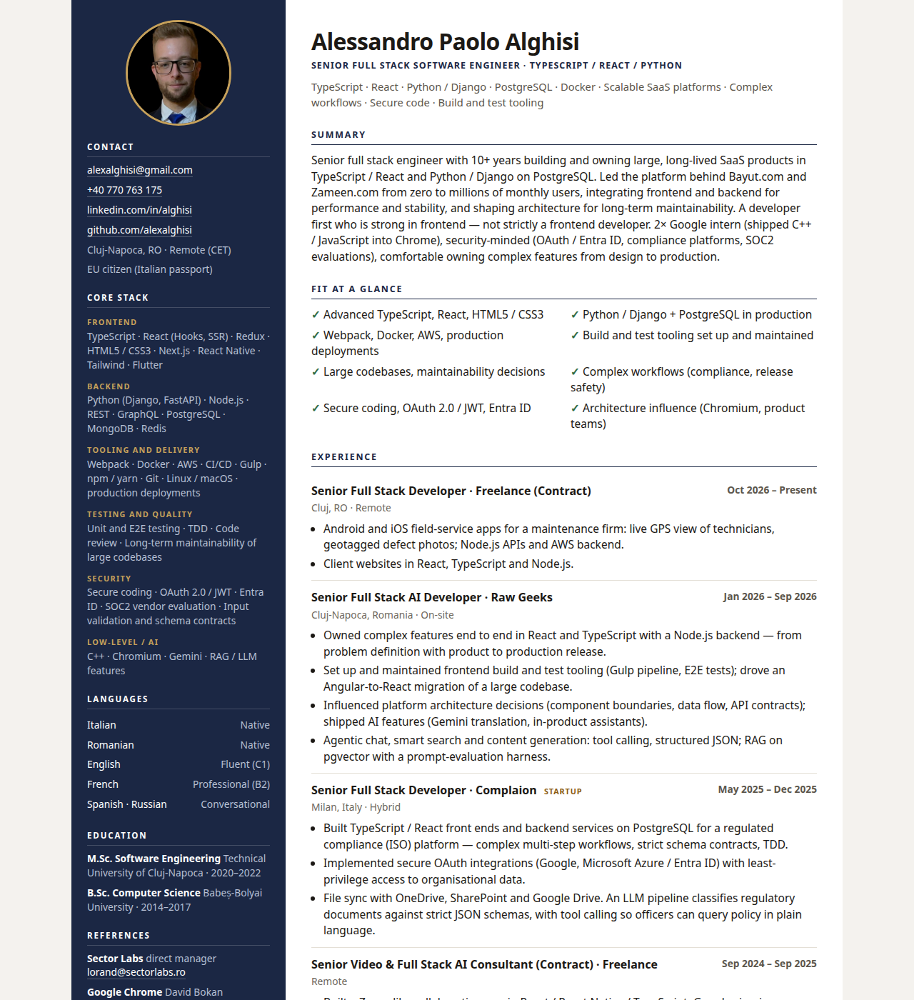
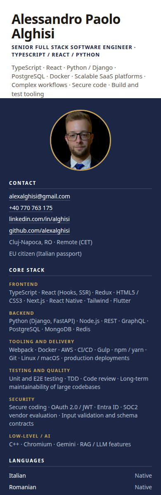

# alexalghisi

CV for Alessandro Paolo Alghisi. The same layout as the 2026 resume: portrait and stack on the left, roles on the right. Plain text a search engine can read.

**Site:** [alexalghisi.github.io/career-showcase](https://alexalghisi.github.io/career-showcase/)

Preview it locally:

```bash
python3 -m http.server 43123 -d site
```

That serves [http://127.0.0.1:43123/](http://127.0.0.1:43123/).



On a phone the portrait and the highlights sit above the roles.



## Pages

`.github/workflows/pages.yml` publishes the `site/` folder from `main`.

## Desk

The repository also holds a Flutter desk: a command shell and a sheet you can pinch. It is not the published page.

```bash
flutter pub get
flutter test
flutter run -d chrome
```

| command | |
| --- | --- |
| `help` | the list |
| `whoami` | short bio |
| `experience` | roles, newest first |
| `education` | schools |
| `stack` | what I actually use |
| `projects` | things with my name on them |
| `languages` | spoken |
| `awards` | olympiad and the bac |
| `contact` | LinkedIn, GitHub, Cluj |
| `cat` | print `about_me.txt` again |
| `hinge` | open the sheet |
| `clear` | wipe the scrollback |

`flutter test` covers the command shell, the pinch math, the desk widgets, and a check that `site/index.html` stays a CV.

A built copy of the desk is under `release/web`:

```bash
./release/serve.sh
```
