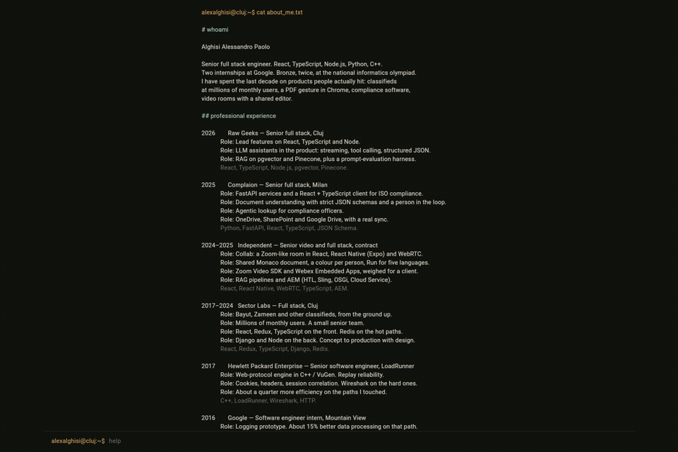
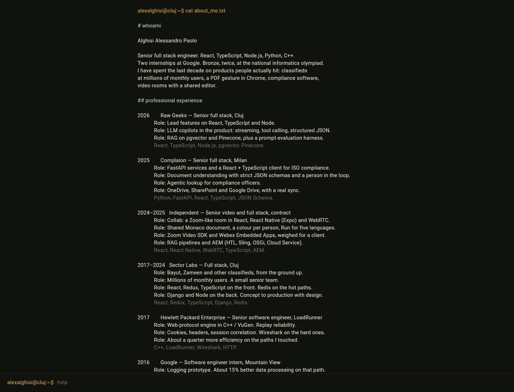
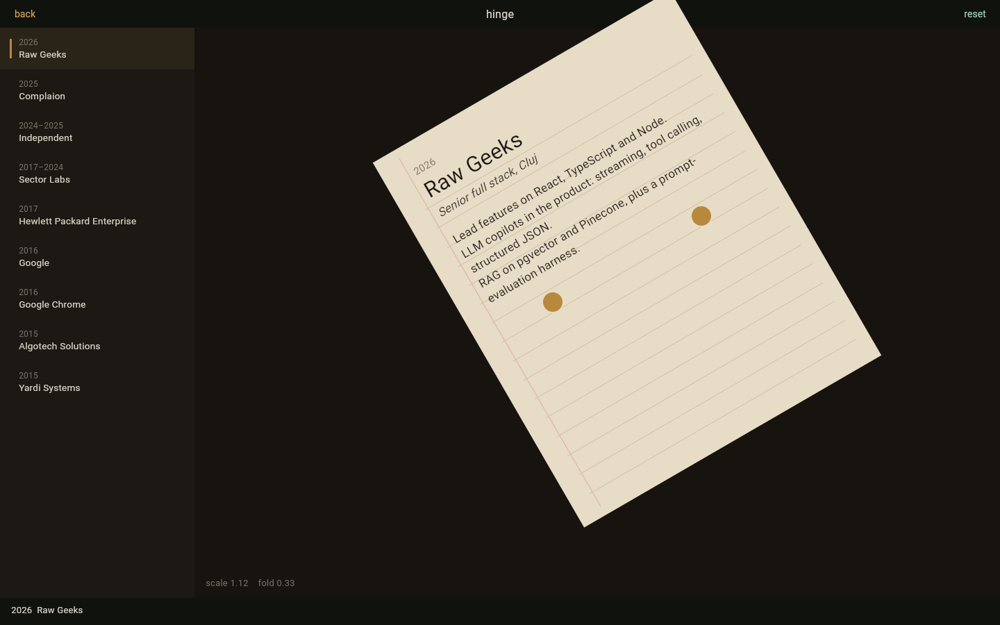
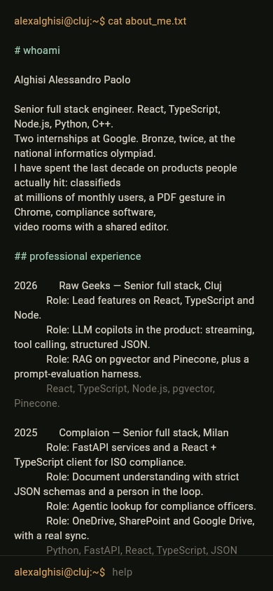

# alexalghisi

Terminal desk for Alghisi Alessandro Paolo. It opens on `cat about_me.txt`. Type `hinge` and the same roles become a sheet of paper: two pins scale it and turn it, and the point between the pins stays where it is.



The stills below are from a local web run of this project.





On a phone the same file just wraps.



## Run

```bash
flutter pub get
flutter test
flutter run -d chrome
```

A built copy, the one GitHub Pages serves:

```bash
flutter build web --release --base-href / --no-wasm-dry-run
python3 -m http.server 43123 -d build/web
```

Open `http://127.0.0.1:43123/`. `http://127.0.0.1:43123/?open=hinge&pose=turned` starts on the sheet, already turned.

For a project site rather than `alexalghisi.github.io`, pass `--base-href /<repo>/`.

## Commands

| command | |
| --- | --- |
| `help` | the list |
| `whoami` | short bio |
| `experience` | roles, newest first |
| `education` | schools |
| `stack` | what I actually use |
| `projects` | things with my name on them |
| `languages` | spoken |
| `awards` | olympiad and the bac |
| `contact` | LinkedIn, GitHub, Cluj |
| `cat` | print `about_me.txt` again |
| `hinge` | open the sheet |
| `clear` | wipe the scrollback |

Arrow up recalls the previous command. On the sheet, `r` resets the pins and escape goes back.

## Tests

`flutter test` runs the unit tests (the command shell and the pinch math), the widget tests for the desk and the sheet, and an end-to-end pass from the prompt through the sheet and back to contact.

`integration_test/desk_flow_test.dart` is the same journey on a device:

```bash
flutter test integration_test/desk_flow_test.dart -d <device>
```

## Pages

`.github/workflows/check.yml` analyzes, tests, and builds on every push. `.github/workflows/pages.yml` publishes `main` to GitHub Pages. In the repository settings, set Pages to GitHub Actions. A user site (`alexalghisi.github.io`) uses base href `/`. A project site needs `--base-href /<repo>/` in that workflow.
